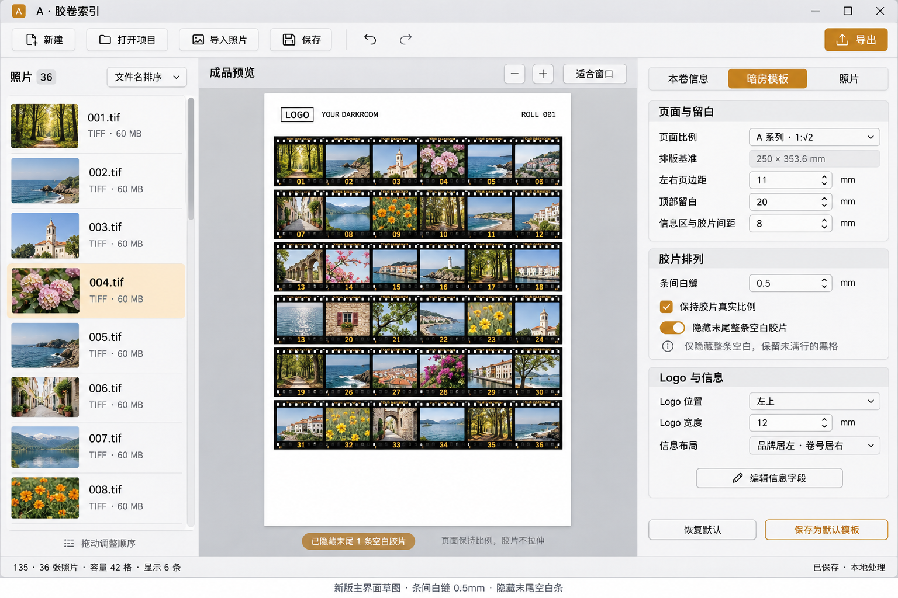

# 胶卷索引应用第一版需求文档

版本：V1.0  
整理日期：2026年11月15日  
应用暂称：A  
用途：第一版设计、开发与验收基线

A 是面向暗房工作人员的离线桌面应用。工作人员导入一卷扫描照片，检查顺序与方向，填写卷信息，使用暗房模板生成高清胶卷索引图，交付客户浏览和选片。

第一版采用网页技术制作界面，由本地图片处理模块处理 TIFF。135 模板容量固定为 42 格，按 6 张一条、7 条排列；页面采用 A 系列纸张比例，胶片保持真实几何比例；条间白缝默认 0.5mm，可调整；末尾整条空白胶片可以隐藏。

本文件中的明确规则作为实现依据。标注“初始值”的参数可以在界面修改；标注“待确认”的项目不应在开发中被当作已经承诺的规格。参考图只用于表达界面结构和视觉方向，数值、计数与行为以本文件为准。

## 1 产品范围与运行环境

### 1.1 使用对象与交付物

使用者是暗房工作人员，不是客户。一次编辑一卷，一卷生成一张索引图，可同时生成高清交付版和便捷预览版。客户通过普通看图工具查看成品，不需要安装 A。

常用输入为 TIFF，每张约 60MB。36 张约 2.16GB、42 张约 2.52GB，这是文件体积估算，不等于内存需求。输入的像素尺寸、位深、压缩方式与色彩配置待确认。

### 1.2 平台与离线原则

- 最终使用平台为 macOS；Windows 用于开发及功能验证，两端共用主要业务逻辑。
- 安装后断网可完成导入、预览、编辑、保存、恢复与导出。
- 图片处理在本机完成，不上传原图、预览图或项目内容。
- 字体、图片解码能力及界面资源随应用提供，不依赖在线资源加载。
- 原始照片不被覆盖、改色、旋转写回或删除。
- 具体桌面框架和图片处理库尚未选定；不得将概念方案中的框架示例视为已定技术选型。
- macOS 最低版本、芯片范围和最低内存，在目标设备确认后确定。

### 1.3 第一版不包含

多卷批量队列、扫描仪直接连接、自动识别胶卷型号、真实底片帧号识别、AI 选片、修图与调色、任意拖放元素的自由设计画布、账号登录、云同步、在线客户选片、自动上传交付、半格和全景等特殊画幅。

## 2 主工作流程

1. 新建一卷或打开已有项目。
2. 拖入一个文件夹或多选照片，选择对应胶卷画幅。
3. 应用检查文件并逐步生成预览，按文件名自然排序。
4. 工作人员检查顺序、方向及缺失位置，必要时旋转、替换、留空或调整顺序。
5. 填写卷号等信息；默认沿用暗房模板，可按本卷调整。
6. 在中央预览区检查最终布局，选择是否隐藏末尾整条空白胶片。
7. 保存项目，选择导出档位与目录，导出索引图。
8. 导出完成后打开成品或所在文件夹。

导入后自动出现排版预览，不设置额外的“生成排版”步骤。编辑操作更新预览；正式高清导出另行从原文件处理。

## 3 输入与照片管理

### 3.1 导入规则

- 支持 TIFF，包括 .tif 和 .tiff，以及 JPEG，包括 .jpg 和 .jpeg，扩展名大小写均可。
- 支持拖入文件夹、多选照片、通过系统文件选择器导入。
- 文件夹默认只读取当前层，不递归导入子文件夹；子文件夹及非图片文件不计入照片数量。
- 列出读取失败或不支持的文件及原因，区分“正在处理”“成功”“失败”，不得静默遗漏。
- 失败文件在工作人员明确移除或替换前，阻止正常交付导出，避免误以为已经包含整卷。
- 重复导入同一路径文件时提示，不悄悄增加副本；不同文件即使画面相似也不自动删除。
- TIFF 不是无限制支持所有变体。具体扫描样本中的位深、压缩和色彩配置需经过验证；多页 TIFF、特殊通道等未确认输入须明确提示，不自动只取一页并当作完整导入。

### 3.2 排序与方向

默认按文件名自然排序，例如 1、2、3、10，而不是 1、10、2。支持手动拖动改变顺序，排序后预览、索引号和导出保持一致。

读取照片方向信息后，按胶片排列方式显示。135 的画面窗口保持横向 3:2，竖拍照片以 90 度侧放进入横向画格，工作人员可向左或向右旋转修正。不得仅凭照片内容猜测并强制纠正方向。

照片等比缩放、完整显示。与目标画格比例不符时，默认留黑边，不拉伸，不自动裁切。第一版不提供裁切或透视校正工具。

### 3.3 编辑操作的含义

| 操作 | 行为 |
|---|---|
| 拖动调整顺序 | 移动照片，其他照片按顺序顺延；不改变照片文件 |
| 左转或右转 | 改变项目中的显示方向，不写回原图 |
| 替换照片 | 保留当前槽位，重新选择输入图片 |
| 设为空位 | 当前槽位变黑，其后照片不前移 |
| 移除并前移 | 从本卷排列移除照片，后续内容前移，末尾补空位 |
| 插入空位 | 在指定位置插入黑格，后续内容顺延，并消耗末尾一个空槽；若会把照片挤出容量，提示并阻止操作 |
| 撤销与重做 | 恢复本次编辑中的排序、方向、空位、文字及模板参数修改 |

黑片、曝光异常图片和画面相似图片均视为正常输入，不自动筛除。“空位”是项目里的无照片槽位，不通过画面亮度识别。

## 4 画幅模板与槽位

| 模板 | 容量 | 排列与阅读顺序 | 外观 |
|---|---:|---|---|
| 135 全画幅 | 42 | 6 列 × 7 行；逐行从左到右、从上到下 | 上下齿孔及黑色片边 |
| 120 6×4.5 | 16 | 4 列 × 4 行；逐行排列；15 张时补一格 | 无齿孔片边 |
| 120 6×6 | 12 | 3 列竖向胶片条，每列 4 张；先上到下，再向右 | 接近三列胶片条的参考布局 |
| 120 6×7 | 10 | 2 列竖向胶片条，每列 5 张；先上到下，再向右 | 无齿孔片边 |
| 120 6×9 | 8 | 2 列竖向胶片条，每列 4 张；先上到下，再向右 | 无齿孔片边 |

开发先完成并验收 135 流程，再接入 120。120 保留在第一版范围内，但实际成像窗口、帧间间隔与对应页面尺寸需要补充确认，不能把 6×6 等名义规格直接当作精确的 60×60mm 成像窗口，也不能套用 135 的 35mm 条高。

工作人员手动选择画幅。应用可以显示图片比例供参考，但不根据照片数量自动决定胶卷规格。

导入数量超过模板容量时，明确显示超量文件，阻止交付导出，要求工作人员移除多余文件、调整画幅或另建一卷。不得截断后只导出前 42 张。

## 5 135 页面与胶片几何规则

### 5.1 页面比例与物理尺寸

页面采用 A 系列竖版比例，宽∶高＝1∶√2。这里的“A4 同比例”不表示必须采用 A4 的 210×297mm 实际尺寸。

初始排版基准为宽 250mm、高 250×√2mm，界面显示约 250×353.6mm。内部保留足够精度，不用显示值反复计算导致比例漂移。

胶片几何使用毫米作为基准单位，统一映射到预览和导出像素。屏幕缩放不改变版式尺寸。输出像素尺寸与物理页面尺寸分开保存；按 100% 实际尺寸打印且打印程序尊重尺寸设置时，才可对应物理尺寸。将成品适配 A4 打印会缩小，不再是原尺寸。

### 5.2 胶片主体

| 项目 | 135 模板规则 |
|---|---|
| 单张画面窗口 | 36×24mm，横向 3:2 |
| 单条胶片总高度 | 35mm，包含画面、齿孔和黑色片边 |
| 每条画格数 | 6 |
| 单帧排列节距 | 按约 38mm 的模板节距建立，含约 2mm 的帧间黑色区域 |
| 六格条带宽度 | 模板按约 228mm 建立；首尾边缘包含在该宽度内，不再次额外叠加 |
| 条带数量 | 容量上限 7 条 |
| 条间白缝 | 默认 0.5mm，仅出现在相邻可见条带之间 |
| 七条主体高度 | 7×35＋6×0.5＝248mm |
| 六条主体高度 | 6×35＋5×0.5＝212.5mm |

36×24mm 的画面窗口和 35mm 条高属于模板的真实几何基准。约 38mm 的节距属于首版的标准化排版约定，不表示重建每台相机的实际走片误差。

齿孔按真实外观的比例、方向和节距绘制，不为放大文字而任意加宽片边，不为铺满页面而拉高条带。正式矢量边框需核对齿孔细节；生成式草图不能当作精密几何素材。

### 5.3 编号与品牌信息

- 单张索引号放在该照片下方的黑色片边内，位于下排齿孔外侧的可用区域。
- 条带之间的白缝只留白，不放编号、行号、说明或品牌文字。
- 有照片的槽位显示索引号，空槽位不显示编号。索引号默认对应槽位次序，插入空位后允许出现跳号，便于保持槽位与文件的映射。
- 索引号不是识别到的真实底片帧号。应用保留索引号与原文件名的对应关系。
- 暗房名称可在上方黑色片边内小尺寸重复显示；字号受片边可用空间约束，不遮挡齿孔或画面。
- 页面顶部可放 Logo、暗房名称和卷信息，底部可显示备注；未填写的可选内容不显示。
- 品牌文字、字体和标识独立设计，不复用参考品牌的名称或 Logo。

### 5.4 空位与隐藏空白条

不足容量时默认在末尾补黑，允许在开头或中间保留空位。空槽延续胶片背景和上下齿孔，不额外画醒目的黑色方框。

提供“隐藏末尾整条空白胶片”开关，初始开启，并可随模板保存。按项目槽位判断，连续位于末尾且所有槽位为空的整条胶片可以隐藏；中间整条空白不自动隐藏，以保留人为安排的位置。已导入的全黑照片仍属于有照片槽位。

| 135 状态 | 开启隐藏时的表现 |
|---|---|
| 导入 36 张，无中间空位 | 显示前 6 条，隐藏第 7 条；容量仍为 42 |
| 导入 38 张，无中间空位 | 显示 7 条，第 7 条保留 2 张照片与 4 个黑格 |
| 导入 42 张 | 显示完整 7 条 |
| 中间人为保留一整条空白，后面还有照片 | 保留中间空白条，仅判断末尾空白条 |
| 所有槽位为空 | 显示空项目引导，禁用交付导出 |

隐藏仅改变可见性，不删除槽位或项目数据；关闭开关后恢复原有条带。隐藏后的剩余胶片不拉伸、不重新放大。页面尺寸保持不变，默认保持主体顶部位置，增加下方余白。

120 竖向模板如启用同一功能，应作用于末尾整列胶片条，而非裁掉每列末尾的单格；对应视觉稿需在 120 验收前补齐。

## 6 可调整参数与约束

### 6.1 参数清单

| 参数 | 初始值或状态 | 调整规则 |
|---|---|---|
| 页面比例 | 1∶√2，竖版 | 第一版固定为 A 系列比例，不自由拉伸 |
| 页面排版基准 | 250×353.6mm | 允许扩大，宽高联动；扩大不改变胶片尺寸 |
| 左页边距 | 11mm | 非负值，可与右边距关联 |
| 右页边距 | 11mm | 非负值，可独立调整 |
| 顶部留白 | 20mm | 页面顶部到顶部信息区的最小距离 |
| 底部留白 | 需在精确排版稿确定 | 作为底部内容与页边之间的最小距离，不用它强行拉高主体 |
| 信息区与胶片间距 | 8mm | 信息区实际高度之后到第一条胶片之间的距离 |
| 条间白缝 | 0.5mm | 非负毫米数，支持小数精确输入及微调 |
| 胶片主体水平对齐 | 居中 | 可选左、居中、右，在有效版心内对齐 |
| 胶片主体垂直对齐 | 顶部 | 可选顶部、居中、底部；受信息区与页边界约束 |
| 胶片真实几何比例 | 保持 | 第一版作为固定规则，不提供解除后拉伸照片的功能 |
| 隐藏末尾整条空白胶片 | 开启 | 可切换，保存到模板和项目 |
| Logo 显示 | 有素材时显示 | 无素材时正式成品不输出示意 LOGO |
| Logo 位置 | 左上 | 提供左上、顶部居中、右上及页脚区域预设，支持位置偏移 |
| Logo 宽度 | 草图初始 12mm | 等比缩放，高度随素材比例计算 |
| Logo 偏移 | 水平 0mm，垂直 0mm | 相对所选区域锚点调整；边界和重叠检查 |
| 信息布局 | 品牌居左，卷号居右 | 使用预设布局及数值微调 |
| 信息字段 | 卷号、型号、日期、备注等 | 可切换显示、排序、调整字号与对齐 |
| 页背景与片边颜色 | 浅色页面、黑色胶片 | 可配置；不得让编号、文字失去可读性 |
| 片边文字 | 暗房名称 | 可显示或隐藏；字号与位置不能越出可用片边 |
| 模板名称 | 默认模板 | 可命名保存、设为默认、恢复默认 |

上表中的 11mm、20mm、8mm 和 12mm 是已展示草图的初始输入值，不表示已完成印刷级定稿。0.5mm 白缝、A 系列页面比例、135 容量与真实胶片几何是本版明确基线。

### 6.2 位置与空间的计算

信息区高度由 Logo、可见字段、字号和换行共同决定。顶部留白不等于胶片到页面顶部的距离；胶片起点还包括信息区高度和信息区与胶片的间距。

左右页边距定义最小安全区域，实际片边到纸边的距离还受主体对齐影响。顶部或底部对齐不能把胶片移入品牌或备注区域。

页面尺寸、胶片原尺寸和任意大的页边距不能同时无限满足。出现溢出或重叠时，应指出对应参数，阻止有问题的导出，并提供以下处理方式：

1. 减小留白、Logo、字号或间距，或隐藏可选信息。
2. 选择扩大同一比例的页面，明确显示调整后的毫米尺寸。

不得静默缩小胶片、裁切内容、压缩照片比例，或在用户不知道的情况下自动扩大页面。

第一版使用位置预设和数值微调，不实现任意元素的自由拖拽设计器。参数调整即时反映在中央预览中。

## 7 主界面与交互

### 7.1 已确认的界面参考

此图确定顶部工具栏、左侧照片列表、中央成品预览和右侧参数面板的结构。图中的照片、品牌、细小文字、索引号、像素级间距及部分控件仅为示意，不是输出素材。正式实现中的计数、编号和物理比例按本文件计算。

### 7.2 区域职责

| 区域 | 必需内容 |
|---|---|
| 顶部工具栏 | 新建、打开项目、导入照片、保存、撤销、重做；右上角导出主按钮 |
| 左侧照片栏 | 缩略图、文件名、索引号、处理状态；自然排序与拖动换序；滚动查看 |
| 中央预览区 | A 比例完整页面、缩放、平移、适合窗口；单击选择、双击检查单张 |
| 右侧本卷信息 | 画幅、卷号或订单号、胶卷型号、冲扫日期、备注 |
| 右侧暗房模板 | 页面与留白、胶片排列、Logo 与信息、保存为默认模板 |
| 右侧照片 | 当前照片信息、旋转、替换、留空及移除操作 |
| 底部状态栏 | 画幅、照片数量、空位数量、模板容量、显示条数、处理进度与保存状态 |

以新版草图的区域关系为准：左侧约占五分之一，中央占主要空间，右侧足够容纳完整字段。侧栏可以收起，窗口变化时中央页面等比适应，不改变导出布局。

新项目中央显示拖入文件夹、选择照片、打开项目入口。导入进度逐张更新；单张失败有明确标记。选中照片时左侧、中央和右侧同步定位。

界面显示“正在保存”“未保存”“已保存”等真实状态，不在尚未落盘时显示已保存。预览中的选择框、辅助线、隐藏提示、处理状态和缩放工具不进入成品。

### 7.3 导出面板

点击导出后选择高清交付版、便捷预览版或两者，查看整图像素宽高、每格实际分配的像素尺寸、页面毫米尺寸与保存目录。显示不可导出的原因，例如超容量、缺失文件、失败文件、布局溢出或任务尚未完成。

导出过程中提供进度与取消。成功后显示打开图片、打开文件夹入口。取消或失败不得留下看似完成的半成品；已存在的成品不因失败被破坏。

## 8 本地图片处理与清晰度

- 导入登记原文件引用，生成本地预览缓存，不把整卷原图无条件复制到项目。
- 控制同时解码的数量，使用逐张或有限并行的方式，避免所有 TIFF 同时完整展开。
- 界面排版使用预览图，细节检查按需加载；主界面保持响应。
- 正式导出从原文件读取，按目标画格的像素尺寸缩放后合成，不使用界面截图或低分辨率缩略图冒充高清。
- 预览和导出使用同一份排列及几何参数，避免位置、旋转、编号或留白不一致。
- 不自动调色、锐化、降噪或美化照片；用户已经完成的扫描色彩处理不被另加风格。
- 读取色彩配置，交付 JPEG 转换为 sRGB 并嵌入配置。转换是色彩管理，不是自动调色。
- 缺少或损坏的色彩配置需明确提示；采用何种默认解释规则在样本检查后确定，不静默任意指定。
- 缓存可清理并可重建，不因清理缓存而丢失项目编辑。缓存大小上限与清理策略在性能验证后确定。
- 若原图像素不足以达到所选导出档位，提示实际限制；放大不能被描述为增加真实细节。

界面可响应和任务可取消属于验收要求；导入秒数、导出秒数及峰值内存指标需要使用实际 TIFF 和目标 Mac 测量后确定。

## 9 项目与模板保存

项目至少记录：项目格式版本、原文件引用、画幅、槽位与排序、旋转、空位、索引号映射、卷信息、页面尺寸、当前模板参数快照、隐藏空白条开关和导出偏好。

项目默认不包含原图，保存或打开时应让用户明确了解这一点。原文件被移动后，可重新定位单个文件或原图文件夹；未重新定位的照片不能用旧缓存冒充原图完成高清导出。

支持保存、另存项目和重新打开。有未保存修改时，新建、打开其他项目或退出应提供保存、放弃、取消；不要求每一步编辑都弹确认。

模板保存品牌素材和默认布局。项目保存当时使用的模板快照；以后修改默认模板不改变已有项目，除非用户主动重新应用。Logo 作为项目或模板的可持久化资源保存，避免素材移动后无声消失。

图片缓存与项目文件分开管理。默认输出目录可以记住，但打开项目后目录不可用时需重新选择，不能无声改存到未知位置。

## 10 导出规格与文件处理

| 项目 | 第一版要求 |
|---|---|
| 格式 | JPEG，8 位交付输出；TIFF 原图不变 |
| 档位 | 高清交付、便捷预览，可同时导出 |
| 画布比例 | A 系列竖版比例，像素取整允许不超过必要舍入误差 |
| 输出尺寸 | 显示准确像素值；默认档位待真实样本验证 |
| 色彩 | sRGB 并嵌入色彩配置 |
| 文件名 | 默认“卷号_索引_高清.jpg”和“卷号_索引_预览.jpg”，允许修改 |
| 卷号未填 | 提示补充或明确使用替代文件名，不输出误导性示例卷号 |
| 重名 | 由用户选择覆盖或另存，不自动覆盖 |
| 输出内容 | 仅成品页面，不包含编辑控件、选中框或辅助提示 |
| 物理尺寸 | 保存与毫米基准对应的分辨率信息；界面说明实际打印需使用 100% |

JPEG 质量、每格目标像素、整图像素上限与大图内存限制待验证。不得只标注“高清”而不显示像素规格。第一版不把 PDF、TIFF 成品或应用内直接打印列为必需导出能力。

标准纸张打印时，初始 250×353.6mm 版式可放入 A3 保留原尺寸；扩大后的页面需重新检查是否放得下。A4 适配打印会缩小。实际设备的可打印区域仍需由打印程序处理，屏幕预览不承诺与实物等大。

## 11 异常状态与反馈

| 情况 | 必需反馈及处理 |
|---|---|
| 文件损坏或 TIFF 变体不支持 | 标记文件及原因，允许替换或明确移除，不能跳过后报告全部成功 |
| 超过容量 | 显示数量差异与超量文件，解决前不导出 |
| 原图路径失效 | 提供重新定位，禁止只用缓存导出高清 |
| 页面布局溢出或内容重叠 | 标出冲突，调整参数或由用户选择扩大页面 |
| 输出目录不可写或磁盘空间不足 | 提示重新选择目录或释放空间，不显示成功 |
| 用户取消任务 | 停止后续处理，清理未完成输出，保留已保存项目和已有成品 |
| 导出失败 | 显示失败原因与重试入口，不覆盖正常成品为损坏文件 |
| 未保存退出 | 保存、放弃、取消三个明确选项 |
| 导出两档仅一档成功 | 分别显示结果，不能将整体任务标为全部成功 |

## 12 验收用例

| 编号 | 场景 | 通过条件 |
|---|---|---|
| AC01 | 完全断网 | 导入、编辑、保存恢复和导出均可完成，无在线资源依赖 |
| AC02 | 36 张 135，关闭隐藏 | 42 槽，7 条；末尾整条黑色，尺寸与其他条带一致 |
| AC03 | 36 张 135，开启隐藏 | 显示 6 条，容量仍为 42；页面尺寸和照片尺寸不变 |
| AC04 | 38 张 135，开启隐藏 | 显示 7 条，最后 2 张照片与 4 个黑格均保留 |
| AC05 | 42 张及 43 张 135 | 42 张完整显示；43 张明确超量且阻止导出，无漏图 |
| AC06 | 空项目及全部清空 | 显示引导，不导出没有照片的交付图 |
| AC07 | 文件名 1、2、10 | 自然排序正确，手动换序后保存、恢复、导出一致 |
| AC08 | 旋转和非标准比例图片 | 原文件不变，无拉伸或意外裁切，留黑边规则一致 |
| AC09 | 中间空位及中间整条空白 | 留空位置正确，不被隐藏末尾空白功能误删 |
| AC10 | 已导入的全黑照片 | 视为有照片，不作为无内容空槽隐藏 |
| AC11 | 0.5mm 白缝 | 预览与导出由毫米参数计算；七条主体高度按 248mm 计算 |
| AC12 | 编号与片边文字 | 编号位于下黑边，条间白缝没有文字，空位不显示索引号 |
| AC13 | 改页边距与 Logo | 正常范围实时预览；越界提示，不缩图、不裁切、不悄悄扩页 |
| AC14 | 模板保存与项目快照 | 新项目沿用默认；已有项目不被新默认模板改变 |
| AC15 | 缺失或失败原文件 | 导出前明确阻止遗漏，重新定位或处理后恢复 |
| AC16 | 高清导出 | 按原文件生成，尺寸符合档位，预览和成品的几何、顺序、方向一致 |
| AC17 | 色彩与 TIFF 样本 | 已确认的 TIFF 位深、压缩、配置均可读取，输出符合 sRGB 规则 |
| AC18 | 保存后重开 | 卷信息、槽位、方向、空位、模板、隐藏开关均恢复 |
| AC19 | 取消、重名、导出失败 | 无损坏成品冒充成功，无原图修改，无未授权覆盖 |
| AC20 | 目标 Mac 连续处理多卷 | 界面可响应、任务可取消，缓存和内存不持续无界增长 |
| AC21 | Windows 与 Mac 对照 | 同一项目样例的排序、几何、字体布局和导出尺寸一致 |
| AC22 | 各 120 模板 | 容量、顺序、无齿孔边框和比例正确，精确规格确认后验收 |

## 13 开发与平台验证顺序

1. 确认真实 TIFF 样本和目标 Mac 配置，验证解码、色彩与基础导出能力。
2. 完成 135 毫米布局模型与原图导出，使用合成测试图核对画格、条高、白缝、编号和空位。
3. 接入已确认工作台、单卷编辑、模板和项目保存。
4. 完成 120 模板与样本验证。
5. 在目标 Mac 验收安装包、Finder 拖入、中文文件路径、外置存储、连续多卷及断网使用。
6. 根据实际测量确定导出默认档位、内存策略和性能目标，完成发布包检查。

首次可导入并导出的小版本即安排 Mac 测试，不等 Windows 开发全部完成。云端 macOS 构建可辅助打包与自动检查，但不替代目标 Mac 的人工操作验收。正式分发的签名、公证及安装方式在发布阶段确定，不要求上架应用商店。

## 14 待确认项目

| 项目 | 需要补充的内容 | 影响范围 |
|---|---|---|
| TIFF 样本 | 像素尺寸、8 或 16 位、压缩、色彩配置、是否多页及是否带扫描边框 | 解码兼容、色彩和内存 |
| 目标 Mac | 芯片、内存、macOS 版本、原图位于内置或外置磁盘 | 平台范围与性能目标 |
| 120 几何 | 实际成像窗口、帧间隔、条宽和方向样例 | 120 的毫米级模板 |
| 品牌素材 | 暗房名称、Logo、字体及可用素材 | 正式模板视觉 |
| 精确版式 | 底部最小留白、片边文字位置、齿孔尺寸与字体可读性 | 输出几何与细节校样 |
| 导出档位 | 每格像素、JPEG 质量、整图上限和命名细节 | 清晰度与交付体积 |
| 无 ICC 输入 | 缺少色彩配置时的解释规则 | 颜色一致性 |
| 性能指标 | 真实样本上的导入与导出耗时、峰值内存、缓存上限 | 性能验收 |
| 发布支持 | 是否分发给其他工作人员、安装方式、签名公证和系统支持范围 | Mac 发布包 |

待确认项目在相关实现或验收前补齐，不以未经验证的承诺填空。它们不改变已确定的产品架构、工作台布局、135 容量、0.5mm 默认白缝和空白条处理规则。

## 15 基线维护

后续变更需在本文件中更新对应规则与验收用例，保留版本号和变更日期。优先采用明确的文字参数与行为约定；参考图与文字冲突时以文字为准。新需求不能通过改动草图中的一个示意值，未经说明地替换既定行为。

V1.0 已整合：离线桌面架构、TIFF 工作流程、135 与 120 范围、A 比例页面、真实胶片几何、0.5mm 可调白缝、片边编号、末尾空白条隐藏、可调模板、项目保存、异常状态与验收标准。
